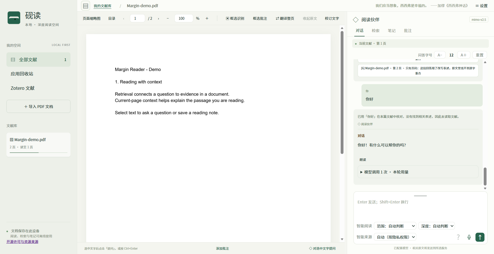

#  勘读 · KanRead

**面向人文社科研究的一站式文献工作台。** 读文献、翻译、批注、笔记、检索都在同一个窗口里完成，数据默认留在本机；**只有你主动启用的外部服务（模型、解析、翻译、联网搜索等）会收到相应内容**（见下文「数据外发说明」）。

现在的 AI 工具大多只解决"问一句、答一句"。但真正做研究要的是另一件事：**读完一篇文献的完整链路**——读懂它、把关键处译过来、标出批注、记下笔记，然后在你积累的全部文献里检索。勘读把这五件事放在一起，并且坚持一条底线：**说不清出处的结论，宁可不说。**

## 它解决什么问题

通用的 AI 问答读论文有三个老毛病：**编造**（说得像原文里有，其实没有）、**丢来源**（给一段结论但不知道出自哪一页）、**读不完**（长篇文献放不进一次请求，读完也不告诉你读了多少）。

勘读针对这三点：

- **每句结论对得上原文**：回答生成后会**逐段核对**是否有原文依据，缺证的段落标为「待核对」而不是冒充结论；引用分三档如实区分——逐字核验的摘引、仅用于定位的锚点、只有页码。
- **引用能跳回那一行**：点引用编号跳到对应页并高亮那句话，不是只给个"第 7 页"。
- **长文献如实处理**：装得下就一次读完，装不下就连续分批读完并**如实报告读到哪、还剩哪些页**；报告里有覆盖台账，说明这一轮检查了哪些方面、哪些只是"这批原文里没见到"。
- **默认在本机处理**：文献、批注、笔记、译文都存在本地 SQLite；全文索引、稀疏向量、重排、OCR 全在本机跑。**"本地运行"不等于"不出网"**——只有你启用了模型/解析/翻译/联网等外部服务，相应内容才会发到对应地址；不启用时这些能力不启用，阅读、检索、OCR、批注与笔记仍全部在本机完成。

## 怎么用

**最短路径（三步）**：① 双击 `start.bat` 装一次依赖，之后双击 `勘读.exe` 启动；② 点「＋ 导入 PDF 文档」；③ 选中原文按 Ctrl+Enter 提问。模型是**可选**的：不配也能用本机检索、OCR、批注与笔记。

第一次打开会有一个简短的「三步开始」引导；之后随时可以点右上角「? 快速开始」查看每个功能在哪儿。

1. **装一次**： **`安装 Python 3.11+`** ， **`双击start.bat`** 安装依赖；之后双击项目根目录的 **`勘读.exe`** 启动（它会等后台就绪，再用本机 Edge 打开窗口）。关闭窗口后本地服务会自行退出。
2. **导入文献**：「＋ 导入 PDF 文档」。原文件按原始字节保存，只渲染与索引，不改写文献、不替换文献字体。
3. **配置模型**（可选）：设置 →「模型服务」添加平台与 API Key，再在「会话模型 / Embedding / Rerank」里选用。**不配也能用**——本机检索、TF-IDF 向量、重排和 OCR 都可用，只是解释与总结需要模型。
   另外，「识别」可接 MinerU 等解析服务（在线解析会把页面图像/文件发到该服务）、「翻译」可接翻译服务（只发当前段原文）、「联网搜索」默认关闭；**启用哪一项，就只有该项需要的内容会发到所选服务**。
   需要走代理时：设置 →「网络」选「跟随系统 / 手动指定 / 直连」，点「测试连接」可看到实际走向与耗时；本机模型（Ollama 等）自动直连。
4. **提问**：选中原文后点「对选中文字提问」（或 Ctrl+Enter），也可以直接提问。范围由问题与选文自动决定，不需要手动切换精读 / 泛读。**长文献读取前会先告知预计页数与 token（估算），确认后才开始**；取消不会读取、也不会留下进度。
5. **读结果**：答案带引用编号，点编号跳回原文；展开报告可看逐段核对结果与覆盖台账。
6. **翻译**：工具栏「⇄ 翻译整页」在右侧开译文栏——原文页与译文并排，逐段对应；也可以只翻选中的一段，或在工作台一键发起整篇后台翻译。译文逐段存在本机、可随时修改或换服务重译。翻译服务在「设置 → 翻译」里配置。
   **双向定位（段级）**：点译文里的整段会跳到原文对应页并框出区域（拿不到精确框时明确提示"只定位到页"）；悬停译文段会在原文上临时描边；点原文一行文字会把译文栏滚到对应段。译文栏顶部的「同步滚动」默认关闭，开启后滚译文会带动原文，手动翻页/选文后会暂停 2.5 秒。
7. **批注与笔记**：选中文字可高亮、下划线、写批注；**批注锚点始终落在原文上**——在译文里选文字加批注时，本机会反查回对应原文，译文侧按句级对齐画出同样的标记。笔记按页或整篇记录，随文献保存在本机，可导出 Markdown。
8. **检索**：在已导入的全部文献里做全文检索，命中后可跳回原文那一页；配置了 Embedding 服务时还会做语义检索，译文也能被搜到。
9. **联网搜索**（可选）：默认关闭，在「设置 → 联网搜索」里开启；搜索主题默认逐次确认。

## 文件与备份

导入的 PDF 会在 `data/` 里保存一份副本，**之后原文件删除、移动或改名都不影响**阅读、检索、批注与翻译。从 Zotero 本机附件打开的文献只是**只读链接**（不复制）：卸载 Zotero 或移动附件后会读不到，文献工作台会把这类文献标为「附件缺失 / 附件已变化」，可以**重新连接**一份 PDF；准备卸载 Zotero 之前，也可以在文献卡片上把要留的文献**保存为本机副本**。应用从不改写你导入的 PDF。

所有副本、批注、笔记与索引都在 `data/` 里；**备份就是复制整个 `data/`**。「设置 → 数据与更新」里有立即备份按钮（更新脚本替换前也会自动备份）。

## 更新

更新只替换程序文件，**不会动 `data/` 与 `.venv/`**，并且替换前会自动备份 `data/`，任何一步失败会回滚已替换的文件——不再需要"先运行一次新版本生成 data/，再用旧 data 覆盖"：

1. 关闭勘读窗口，下载新版本压缩包（**不要**解压覆盖到程序目录）；
2. 在程序目录打开 PowerShell，运行 `scripts\update.ps1 -Zip <新包路径>`（建议先加 `-DryRun` 只看计划）；
3. 更新完成后重新双击 `勘读.exe`。

「设置 → 数据与更新」里有一键复制命令、立即备份与导出诊断包；更新前会自动备份 `data/`，失败会回滚。

## 核心能力

- **按问题确定范围的阅读**：需要全文时完整读取；容量只决定"一次读完"还是"连续分批读完"，不改变覆盖口径。
- **证据银行**：分批读完后，每一批逐字核验过的摘引由本机原样保留，只有派生分析参与压缩——**压缩不会吞掉已核验的原文**。
- **范围由正文复核**：局部提问时先用问题术语在已索引全文里核对一遍，把"计划之外但正文确实在谈"的页补进来；读完再做缺口检索，命中未读页就补读。没查全时会明确说"这次没有查全"。
- **逐段可核对**：报告列出每段的支持依据与逐字摘引，也能直接看到哪些段落没有通过核对。
- **无关区域屏蔽**：为每篇文献框选页眉、页脚、页码或水印所在的区域，可只作用于**本页**或**所有页**；被屏蔽的文字不参与阅读、检索与引用定位，规则可随时查看与删除。只影响本机索引，不改写 PDF 文件。
- **Zotero 批注迁移**：从 Zotero 打开的文献，可把其中的高亮、下划线与便签一次性迁移成本应用批注（分批预览、去重、定位不到的如实标为页级批注）；迁移只读 Zotero，不改动它。
- **导出带批注的 PDF 副本**：批注页签可导出新 PDF 副本，别人用普通阅读器打开也能看到高亮/下划线/便签；原文件不改写。旋转页上的批注本版不写入副本（仍保留在本应用），界面会如实提示写入/未写入条数。
- **原文 ↔ 译文双向定位（段级）**：点译文段落跳到原文对应页并框出区域（拿不到精确框时明确说"只定位到页"）；悬停译文段在原文上临时描边；点原文文字行会把译文栏滚到对应段。「同步滚动」默认关闭、不记忆，手动翻页/选文后自动暂停。
- **文档导航索引（试点，默认关闭）**：可为单篇文献生成本机"页 → 标签"导航（章节标题/页面首行，不调用模型），只用于建议"该读哪几页"，**不参与回答内容与证据**；文件或无关区域变化后自动过期，可随时删除。
- **发送前预算确认**：读取长文献前先告知"预计 N 页 / 约 M token（估算）"，确认后才开始；取消不会读取、也不会产生阅读进度。

## 数据外发说明（重要）

勘读默认在本机运行，但它**不是断网软件**：只有你在「设置」里主动启用了某个外部服务（模型、解析、翻译、联网搜索等），应用才会把该服务所需的内容发出去；什么服务都不启用时，不会调用外部模型或解析服务。

| 你启用的能力 | 会发送出去的内容 | 默认状态 |
|---|---|---|
| 会话模型（问答、阅读、解释） | 问题、选中文字、相关原文片段、最近对话 | 未配置时不调用 |
| 翻译服务（可复用会话模型，也可单独配置） | 当前待翻译的段落/句子 | 未配置时不调用 |
| Embedding | 待索引的文档文本、检索问题 | 可选 |
| Rerank | 问题与召回的原文片段 | 可选 |
| 视觉识别（页面图像交给带图像能力的模型） | 你显式允许后才发送页面图像 | 默认关闭 |
| MinerU 在线 / 自建解析服务 | 需要识别的页面或文件 | 可选，默认本机识别 |
| 语音识别 / 合成（可选） | 录音音频或待朗读文本 | 未配置时不调用 |
| 联网搜索 | 搜索词、你批准的公开网页 | 默认关闭、逐次确认 |
| 连接测试 / 网络自检 | 目标根地址的一次只读请求（不含 API Key 内容） | 点按钮才发生 |
| 更新 / 备份 / 诊断包 | 不联网；文件只在本机读写 | — |

- 发送目标就是你选择的服务（模型、解析、翻译等服务的提供方）：自建/本地服务用你填写的地址；第三方在线服务（如 MinerU 在线）用其官方地址，内容会发送到该服务商；使用本地部署（Ollama、LM Studio、自建解析服务）时，内容不出这台机器或局域网。
- API Key 用当前 Windows 账户的 DPAPI 加密保存在本机，网页只获知"是否存在密钥"，不回传明文。
- 想要完全离线：不启用任何外部服务，只用本机阅读、检索、OCR、批注、笔记与导出。

## 数据与隐私

- 文档与数据库在 `data/`，**不纳入版本控制**，可用 `READER_DATA_DIR` 改位置；备份时停服务后复制整个目录（或在「设置 → 数据与更新」里一键备份）。
- 本地接口只接受**本应用页面**：每次启动生成一枚一次性访问令牌并只注入页面，其他网站或本机其他网页应用无法直接调用。
- 文献正文、OCR 结果与网页内容一律当作**不可信输入**：模型只把它们当资料，不执行其中的"指令"；权限判断（例如"仅文献"）在本机代码里执行，模型不能改。
- 运行日志 `data/application.log` 按大小轮转（2 MB × 5 份），不会无限增长；「设置 → 数据与更新」可导出**脱敏**诊断包（不含文献正文、批注内容或密钥），用于排查问题。
- Windows 上 API Key 用当前用户的 DPAPI 加密，网页只获知"是否存在密钥"，不回传明文。
- 具体的发送范围见上方「数据外发说明」；界面在模型面板、设置页与首次引导里也会提示。
- 联网搜索**默认关闭**，只在「设置 → 联网搜索」里手动开启；开启后"追加搜索"与"读取公开网页正文"是两项独立授权，不会一并打开。

## 许可

- 代码采用 **PolyForm Noncommercial 1.0.0**（见 [`LICENSE`](LICENSE) 与 [`NOTICE`](NOTICE)）。
- 名称与图标不在代码许可证授权范围内，使用边界见 [`legal/BRAND.md`](legal/BRAND.md)。
- 第三方组件与资源的授权状况见 [`legal/THIRD-PARTY.md`](legal/THIRD-PARTY.md)；字体适用 SIL OFL 1.1，全文见 [`static/fonts/OFL.txt`](static/fonts/OFL.txt)。
